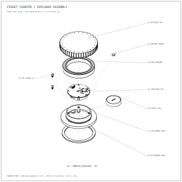
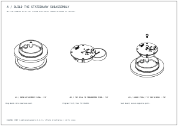
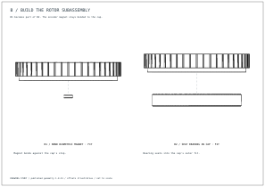
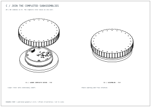

# Fidget-counter exploded assembly example

This example uses the actual published [rushabhcodes/fidget-counter](https://tscircuit.com/rushabhcodes/fidget-counter#3d) version **1.0.31**, V1 circular cap. It renders the reviewed four-sheet study from Circuit JSON with the public drawing converter.

```sh
bun examples/assembly-study/render.ts ./rendered
# Optional last argument: fraction of authored separation (0..1).
bun examples/assembly-study/render.ts ./rendered-half 0.5
```

The output contains four self-contained SVGs and the complete Circuit JSON input. All geometry is cached locally in the fixture; tests and examples require no network.

## Full explosion



## Stationary subassembly

A1 bonds the attachment ring to the base. A2 fits a cell to the programmed PCBA. A3 lowers that complete PCBA and secures two opposite screws.



## Rotor subassembly

B1 bonds the encoder magnet into the cap. B2 seats the bearing into that cap. The cap and bonded magnet remain together.



## Final join

C1 lowers the completed rotor as one unit onto the stationary assembly. C2 shows the assembled device.



## Input and provenance

- `drawing-records.json` is the authored drawing configuration. Exploded panels use `drawing_explosion_view`; the assembled final panel uses `drawing_part_view`. It uses the schemas from the companion Circuit JSON PR, not embedded images.
- `drawings.ts` validates those records and applies an optional explosion factor.
- `geometry.ts` resolves the GLB's source IDs from node extras. PCB substrate and via plating nodes map to `pcb_board_0`.
- `fixture.ts` decompresses immutable assets. `provenance.json` records the published release, artifact ID and SHA-256 of the **decompressed** bytes. Gzip timestamps are zero for reproducibility.
- The original published GLB uses `(-CAD.x, CAD.z, CAD.y)`. The adapter rotates the complete placed scene 180 degrees around glTF Y into canonical `(CAD.x, CAD.z, -CAD.y)`.
- The PCBA includes its substrate and all 27 fitted components. There are seven additional mechanical source IDs; the screw source contains two screws. The complete set has 35 source/board identities across 36 GLB nodes.

The assets are preserved from the linked published design; attribution belongs to rushabhcodes. The package's license metadata is unset; no broader license for the design assets is asserted here. Library code retains this repository's MIT license.

These are outline raster views embedded in SVG sheets with vector annotations. Stage inclusion describes membership, not physical insertion sequencing; offsets and guide arrows are illustrative and do not prove collision-free assembly. Source assembly instructions are retained in `assets/SOURCE_ASSEMBLY.md`. Printed retention, fit and hardware operation remain properties of the original prototype, not validated by these drawing tests.
